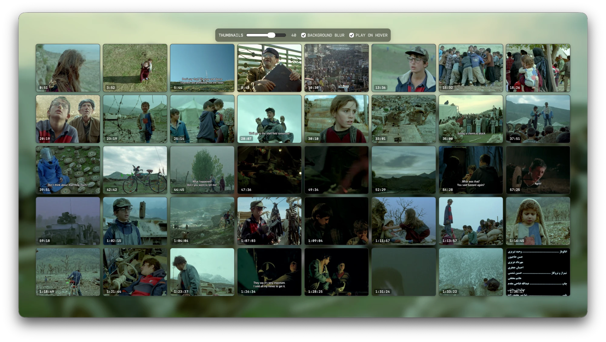

# Thumbnails for IINA

*Feel free to contact me if you have any questions or feedback about this plugin. My details are in the [Author](#author) section below.*

An IINA plugin that shows clickable thumbnails for each video.



## Features

- See a grid of thumbnails from across the video
- Click a thumbnail to jump to that point
- Choose 10, 15, 20, 30, 40, 60, or 100 thumbnails
- Change the number of thumbnails with a simple slider
- Turn background blur on or off
- Hover a thumbnail to play a short silent preview of that part of the video right inside it (optional, needs ffmpeg)
- Move around with the keyboard
- A faint tick sound as you move the slider
- Uses IINA's own thumbnail cache, so it does not create another thumbnail cache
- The grid updates while you resize the IINA window

## Hover preview

Hovering a thumbnail plays a few seconds of the video from that point, inside the thumbnail. It uses [ffmpeg](https://ffmpeg.org) to cut small silent clips, so it only works if ffmpeg is installed:

```
brew install ffmpeg
```

Turn it on or off with the **Play on hover** toggle next to **Background blur**. Without ffmpeg the toggle is greyed out and the thumbnails stay still images; everything else works as before.

## Keyboard

IINA already uses the plain arrow keys, Enter and Esc for seeking and playback, so the plugin uses them with Shift held:

- **Shift + arrow keys** — move the highlight across the thumbnails
- **Shift + Enter** — jump to the highlighted thumbnail
- **0** — open or close the thumbnails

## Install

### From IINA

Open:

**IINA → Settings → Plugins → Install from GitHub…**

Enter:

`aminozuur/iina-thumbnails`

### From a release

Download the latest `.iinaplgz` file from the [Releases](https://github.com/aminozuur/iina-thumbnails/releases) page and open it with IINA.

## Permissions

Thumbnails needs two IINA permissions:

- **Access the file system** — reads IINA's thumbnail cache, and runs ffmpeg for hover previews.
- **Add overlays on videos** — shows the thumbnails and controls on top of the video.

## Author

**Amin Eftegarie**

Email: [amin@eftegarie.com](mailto:amin@eftegarie.com)  
Website: [eftegarie.com](https://eftegarie.com/)

## License

[MIT License](LICENSE.md)
